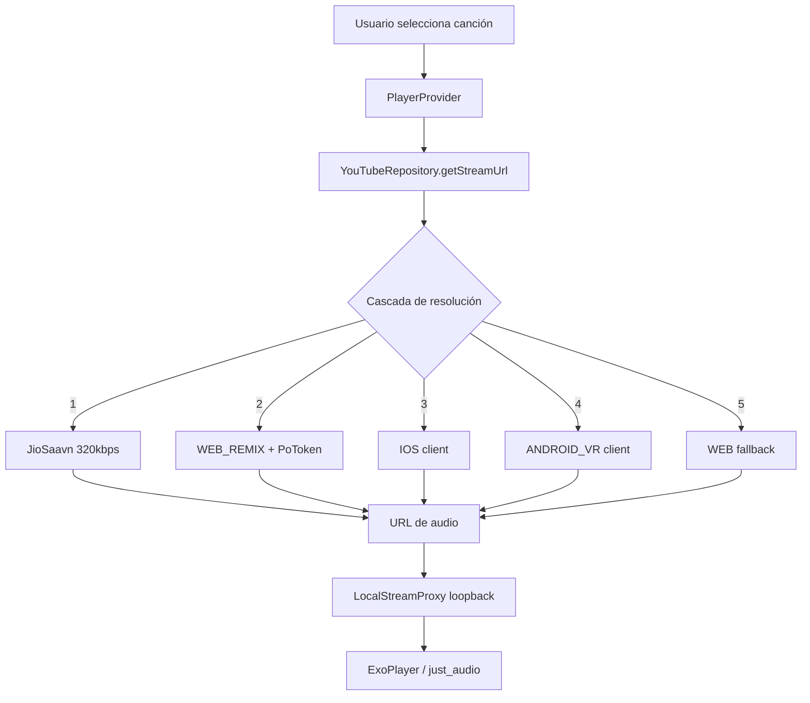
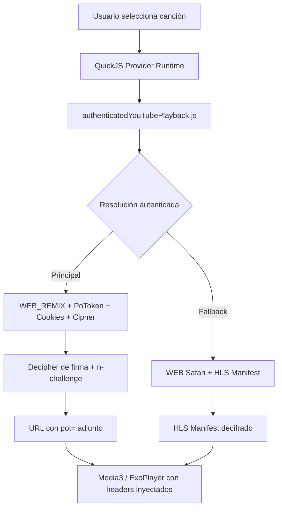
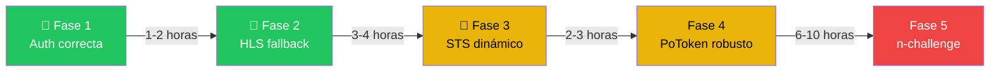

# 🎵 Análisis: FritoMusic Flutter vs Orchard — Reproducción de YouTube

## 📋 Resumen del Proyecto `musicfritoFlutter`

`musicfritoFlutter` es un reproductor de música Flutter para Android que combina música local con streaming de YouTube Music. El proyecto reside en `c:\Users\Argenis\Documents\FritoMusic\musicfritoFlutter`.

### Arquitectura actual



| Componente | Archivo | Función |
|:--|:--|:--|
| **InnerTubeClient** | [`innertube_client.dart`](file:///c:/Users/Argenis/Documents/FritoMusic/musicfritoFlutter/lib/data/network/innertube/innertube_client.dart) | Construye contextos WEB_REMIX, maneja cookies y SAPISIDHASH auth |
| **YouTubeRepository** | [`youtube_repository.dart`](file:///c:/Users/Argenis/Documents/FritoMusic/musicfritoFlutter/lib/data/network/yt/youtube_repository.dart) | Cascada de clientes (Saavn → WEB_REMIX+PoToken → IOS → ANDROID_VR → WEB) |
| **LocalStreamProxy** | [`local_stream_proxy.dart`](file:///c:/Users/Argenis/Documents/FritoMusic/musicfritoFlutter/lib/services/local_stream_proxy.dart) | Servidor loopback HTTP que inyecta headers y segmenta en chunks de 512 KB |
| **PoTokenGenerator** | [`po_token_generator.dart`](file:///c:/Users/Argenis/Documents/FritoMusic/musicfritoFlutter/lib/utils/potoken/po_token_generator.dart) | BotGuard vía WebView oculto; genera tokens de jugador y streaming |
| **FritoAudioHandler** | [`audio_handler.dart`](file:///c:/Users/Argenis/Documents/FritoMusic/musicfritoFlutter/lib/services/audio_handler.dart) | Control de `just_audio` + recuperación de streams fallidos + watchdog |
| **StreamClientUtils** | [`stream_client_utils.dart`](file:///c:/Users/Argenis/Documents/FritoMusic/musicfritoFlutter/lib/data/network/yt/stream_client_utils.dart) | Perfiles de User-Agent/Origin por tipo de cliente YouTube |

---

## 🔴 Problema Actual

**Síntoma:** Al iniciar sesión y reproducir canciones de YouTube, el audio:
- No suena en absoluto, **O**
- Suena entre 30 segundos y ~1 minuto y luego se corta

### ¿Por qué ocurre?

El problema tiene **múltiples capas** que se combinan:

#### 1. El cliente WEB_REMIX + PoToken es la única vía confiable, pero es frágil

YouTube exige un **PoToken (Proof-of-Origin)** generado por BotGuard para el cliente `WEB_REMIX`. Sin él, responde con `UNPLAYABLE`. El generador en Flutter usa un WebView oculto que:
- A veces no se inicializa a tiempo (el prewarm falla silenciosamente)
- En algunos dispositivos Android el WebView no ejecuta JS correctamente → se desactiva el generador (`_disabled = true`)
- Si el PoToken falla, el paso WEB_REMIX se omite completamente

#### 2. Los clientes nativos (IOS / ANDROID_VR) devuelven URLs con throttle severo

Cuando WEB_REMIX falla, la cascada baja a los clientes `IOS` y `ANDROID_VR`. Estos devuelven URLs que:
- Funcionan para los primeros ~1 MB (~30–60 segundos de audio M4A)
- Después de ese umbral, GoogleVideo aplica **throttle agresivo** (~31 KB/s) o directamente **corta la conexión con 403**
- Esto es intencional por parte de YouTube: los clientes nativos sin sesión web autenticada están limitados

#### 3. El proxy local mitiga pero no resuelve el throttle

`LocalStreamProxy` segmenta las peticiones en chunks de 512 KB con `Range` headers, lo cual evita el throttle inicial. Sin embargo:
- Si la URL ya fue generada por un cliente throttleado (IOS/ANDROID_VR), el proxy solo retrasa el problema: GoogleVideo eventualmente rechaza los chunks con 403
- El proxy no puede regenerar la URL si el stream muere a mitad de camino (eso depende del `_recoverFromStreamError` del audio handler)

#### 4. La primera búsqueda es en JioSaavn, que tiene baja tasa de acierto

Saavn solo tiene catálogo indo-oriental robusto. Para música occidental, la tasa de match es ~20-30%, dejando la mayoría de canciones dependientes de la cascada de YouTube.

---

## 🟢 Cómo lo Resuelve Orchard (Referencia de Éxito)

Orchard (ubicado en `c:\Users\Argenis\Documents\FritoMusic\Orchard`) reproduce YouTube Music sin problemas. Su arquitectura de playback es fundamentalmente diferente:

### Arquitectura de Orchard



### Las 7 diferencias clave entre Orchard y FritoMusic Flutter

#### 1. 🔐 Autenticación real del navegador (SAPISIDHASH completo)

**Orchard** ([`browserMusicApi.js`](file:///c:/Users/Argenis/Documents/FritoMusic/Orchard/providers/youtube/src/auth/browserMusicApi.js)):
```javascript
// Genera Authorization con TODAS las variantes del cookie SAPISID
const signedCookies = [
    sapisid && ['SAPISIDHASH', sapisid],
    cookies['__Secure-1PAPISID'] && ['SAPISID1PHASH', cookies['__Secure-1PAPISID']],
    cookies['__Secure-3PAPISID'] && ['SAPISID3PHASH', cookies['__Secure-3PAPISID']]
].filter(Boolean);
// Cada hash es: SHA1(timestamp + papisid + origin)
```

**FritoMusic Flutter** ([`innertube_client.dart`](file:///c:/Users/Argenis/Documents/FritoMusic/musicfritoFlutter/lib/data/network/innertube/innertube_client.dart#L108-L117)):
```dart
// Solo usa SAPISID, ignora __Secure-1PAPISID y __Secure-3PAPISID
final sapisidRaw = cookieMap['SAPISID'] ??
    cookieMap['__Secure-3PAPISID'] ??
    cookieMap['__Secure-1PAPISID'];
// Un solo esquema: SAPISIDHASH
headers['Authorization'] = 'SAPISIDHASH ${now}_$hash';
```

> [!IMPORTANT]
> **Diferencia crítica:** Orchard envía **los 3 esquemas de autorización** (`SAPISIDHASH`, `SAPISID1PHASH`, `SAPISID3PHASH`) en un solo header separados por espacio. FritoMusic solo envía uno. Esto puede causar que YouTube rechace el request como no autenticado → la sesión no se reconoce → se aplica throttle de invitado.

#### 2. 🔑 Descifrado de firma (Cipher / n-challenge)

**Orchard** tiene un sistema completo de descifrado:
- El crate Rust [`orchard-youtube-extractor`](file:///c:/Users/Argenis/Documents/FritoMusic/Orchard/crates/orchard-youtube-extractor/src/lib.rs) parsea el player.js de YouTube usando AST (OXC parser)
- Extrae las funciones de cifrado de firma (`signatureCipher`) y el n-challenge
- [`authenticatedYouTubePlayback.js`](file:///c:/Users/Argenis/Documents/FritoMusic/Orchard/providers/youtube/src/playback/authenticatedYouTubePlayback.js#L268): `await session.player.decipher(format.url, format.signatureCipher, format.cipher)`

**FritoMusic Flutter**: **No tiene descifrado de firma**. Solo usa formatos donde la URL viene directamente en `format.url` (sin `signatureCipher`). Esto limita severamente los formatos disponibles y a veces excluye los de mejor calidad.

> [!WARNING]
> **Impacto:** Sin descifrar las firmas, FritoMusic solo puede usar formatos que YouTube devuelve con URL directa. Muchos formatos de alta calidad (opus 160kbps, m4a 256kbps) requieren descifrado. Además, el **n-challenge** (anti-throttle) no se resuelve, lo que causa el throttle a 31 KB/s en formatos que sí tienen URL directa pero requieren resolver `n`.

#### 3. 📝 Cookies de playback con defaults correctos

**Orchard** ([`browserMusicApi.js`](file:///c:/Users/Argenis/Documents/FritoMusic/Orchard/providers/youtube/src/auth/browserMusicApi.js#L39-L47)):
```javascript
function cookieWithPlaybackDefaults(cookie = '') {
    // Agrega SOCS=CAI y PREF si no existen
    if (!names.has('SOCS')) parts.push('SOCS=CAI');
    if (!names.has('PREF')) parts.push('PREF=f2=8000000&hl=en');
    return parts.join('; ');
}
```

**FritoMusic Flutter**: Pasa las cookies tal cual sin agregar defaults. `SOCS=CAI` acepta cookies funcionales sin banner de consentimiento. `PREF=f2=8000000` es el flag de YouTube que habilita playback HTML5.

#### 4. 🛡️ PoToken con BotGuard nativo (bgutils-js)

**Orchard** ([`webPoMinter.js`](file:///c:/Users/Argenis/Documents/FritoMusic/Orchard/providers/youtube/src/playback/webPoMinter.js)):
- Usa `bgutils-js` directamente (sin WebView)
- `BotGuardClient.create()` → `WebPoMinter.create()` → `minter.mintAsWebsafeString(videoId)`
- Funciona en cualquier entorno JS (Node, QuickJS) sin depender de un WebView Android

**FritoMusic Flutter** ([`po_token_generator.dart`](file:///c:/Users/Argenis/Documents/FritoMusic/musicfritoFlutter/lib/utils/potoken/po_token_generator.dart)):
- Depende de un WebView Android oculto
- El WebView puede fallar por múltiples razones (dispositivo, timing, SyntaxError)
- Se autodeshabilita permanentemente si detecta un SyntaxError

> [!TIP]
> **Orchard ejecuta BotGuard en QuickJS** (un engine JS ligero compilado a nativo), eliminando la dependencia de WebView. FritoMusic podría adoptar un enfoque similar usando un isolate de Dart que ejecute el JS de BotGuard, o usando el paquete `flutter_js` para ejecutar BotGuard sin WebView.

#### 5. 🎯 `signatureTimestamp` dinámico vs hardcodeado

**Orchard**: `session.player.signature_timestamp` se extrae del player.js actual de YouTube. Cambia con cada versión del player.

**FritoMusic Flutter** ([`youtube_repository.dart`](file:///c:/Users/Argenis/Documents/FritoMusic/musicfritoFlutter/lib/data/network/yt/youtube_repository.dart#L209)):
```dart
'signatureTimestamp': 19800, // ← HARDCODEADO
```

> [!CAUTION]
> **Un `signatureTimestamp` incorrecto hace que YouTube devuelva streams inválidos o UNPLAYABLE.** El valor cambia cada vez que YouTube actualiza su player.js. El valor `19800` es correcto solo temporalmente; cuando YouTube actualice, dejará de funcionar sin intervención manual.

#### 6. 📦 Headers completos en el request de player

**Orchard** envía headers extras críticos:
```javascript
'X-Youtube-Bootstrap-Logged-In': 'true',
'X-Goog-Api-Format-Version': '1',
'X-Goog-PageId': authState.browser.dataSyncId,  // Brand Account
'X-Goog-Visitor-Id': authState.browser.visitorData
```

**FritoMusic Flutter**: Envía algunos de estos headers pero no todos en todos los requests (por ejemplo, el request IOS y ANDROID_VR no envían `X-Goog-Visitor-Id` ni cookies de sesión web).

#### 7. 🔄 Fallback inteligente: HLS vía Safari

**Orchard** tiene un fallback a **HLS (HTTP Live Streaming)** vía el cliente `WEB` con user-agent de Safari:
```javascript
async function resolveHls(videoId, session) {
    // Usa WEB (no WEB_REMIX) con Safari UA → devuelve hlsManifestUrl
    // HLS NO tiene throttle y es nativo de Media3/ExoPlayer
}
```

**FritoMusic Flutter**: No tiene fallback HLS. Si todos los clientes de InnerTube fallan, no hay más opciones.

> [!IMPORTANT]
> **HLS es la solución más robusta para Flutter.** ExoPlayer (que `just_audio` usa en Android) soporta HLS nativamente. Un manifest HLS:
> - No requiere proxy local (no hay throttle en HLS)
> - No requiere descifrado de firma (la URL del manifest es directa)
> - Funciona con cookies de sesión autenticada
> - No tiene límite de 1 MB

---

## 🛠️ Plan de Solución: Paso a Paso

### Fase 1: Arreglar la autenticación (Impacto: Alto, Esfuerzo: Bajo)

**Objetivo:** Que YouTube reconozca la sesión como autenticada de verdad.

**Paso 1.1 — Authorization header con los 3 esquemas SAPISID**

En [`innertube_client.dart`](file:///c:/Users/Argenis/Documents/FritoMusic/musicfritoFlutter/lib/data/network/innertube/innertube_client.dart), método `_buildHeaders`:

```dart
// ANTES: solo un esquema
headers['Authorization'] = 'SAPISIDHASH ${now}_$hash';

// DESPUÉS: los 3 esquemas como Orchard
final schemes = <String>[];
final sapisid = cookieMap['SAPISID']?.replaceAll('"', '').trim();
final secure1 = cookieMap['__Secure-1PAPISID']?.replaceAll('"', '').trim();
final secure3 = cookieMap['__Secure-3PAPISID']?.replaceAll('"', '').trim();
final origin = 'https://music.youtube.com';

for (final entry in [
  if (sapisid != null && sapisid.isNotEmpty) MapEntry('SAPISIDHASH', sapisid),
  if (secure1 != null && secure1.isNotEmpty) MapEntry('SAPISID1PHASH', secure1),
  if (secure3 != null && secure3.isNotEmpty) MapEntry('SAPISID3PHASH', secure3),
]) {
  final hash = sha1.convert(utf8.encode('$now ${entry.value} $origin')).toString();
  schemes.add('${entry.key} ${now}_$hash');
}
if (schemes.isNotEmpty) {
  headers['Authorization'] = schemes.join(' ');
}
```

**Paso 1.2 — Cookies con defaults de playback**

Agregar una función similar a Orchard que inyecte `SOCS=CAI` y `PREF=f2=8000000&hl=en` antes de enviar las cookies.

**Paso 1.3 — Enviar `X-Youtube-Bootstrap-Logged-In: true`**

Añadir este header al método `_buildHeaders` cuando `withAuth` es `true`.

---

### Fase 2: Implementar fallback HLS (Impacto: Muy Alto, Esfuerzo: Medio)

**Objetivo:** Obtener un stream que no tenga throttle ni requiera proxy.

**Paso 2.1 — Nuevo método de resolución HLS en `YouTubeRepository`**

Crear un request al endpoint `/player` con contexto `WEB` y user-agent de Safari (como hace Orchard):

```dart
// User-Agent que dispara HLS en YouTube
const safariUA = 'Mozilla/5.0 (Macintosh; Intel Mac OS X 10_15_7) '
    'AppleWebKit/605.1.15 (KHTML, like Gecko) Version/15.5 Safari/605.1.15,gzip(gfe)';

Future<String?> _resolveHls(String videoId) async {
  final client = InnerTubeClient.instance;
  final response = await _dio.post(
    'https://www.youtube.com/youtubei/v1/player?prettyPrint=false',
    data: jsonEncode({
      'context': {
        'client': {
          'clientName': 'WEB',
          'clientVersion': '2.20260708.00.00',
          'userAgent': safariUA,
          'hl': client.hl,
          'gl': client.gl,
          if (client.visitorData != null) 'visitorData': client.visitorData,
        }
      },
      'videoId': videoId,
      'contentCheckOk': true,
      'racyCheckOk': true,
      'playbackContext': {
        'contentPlaybackContext': {
          'html5Preference': 'HTML5_PREF_WANTS',
          'signatureTimestamp': signatureTimestamp, // Dinámico, ver Fase 3
        }
      }
    }),
    options: Options(headers: {
      'Content-Type': 'application/json',
      'User-Agent': safariUA,
      ...client._buildHeaders(withAuth: true),  // Con cookies y auth
    }),
  );

  final hlsUrl = response.data?['streamingData']?['hlsManifestUrl'];
  if (hlsUrl != null && hlsUrl.toString().isNotEmpty) {
    return hlsUrl.toString();
  }
  return null;
}
```

**Paso 2.2 — Reproducir HLS directamente sin proxy**

`just_audio` soporta HLS nativamente en Android:
```dart
if (hlsUrl != null) {
  await _player.setAudioSource(
    AudioSource.uri(
      Uri.parse(hlsUrl),
      headers: {'User-Agent': safariUA},
    ),
  );
}
```

**No necesita `LocalStreamProxy`** porque HLS es un protocolo adaptivo que maneja sus propios chunks internamente.

**Paso 2.3 — Integrar HLS en la cascada de resolución**

En `YouTubeRepository.getStreamUrl`, insertar el intento HLS **después de WEB_REMIX+PoToken y antes de IOS**:

```
1. Saavn (sin cambios)
2. WEB_REMIX + PoToken (sin cambios)
3. ★ NUEVO: WEB + Safari → HLS manifest
4. IOS (sin cambios, como respaldo)
5. ANDROID_VR (sin cambios, como respaldo)
```

---

### Fase 3: Obtener `signatureTimestamp` dinámicamente (Impacto: Alto, Esfuerzo: Medio)

**Objetivo:** Eliminar el valor hardcodeado `19800` que dejará de funcionar.

**Paso 3.1 — Descargar y parsear el player.js**

```dart
/// Obtiene el signatureTimestamp actual del player.js de YouTube.
Future<int?> _fetchSignatureTimestamp() async {
  try {
    // 1. Obtener la URL del player.js desde la página de YouTube
    final pageResp = await _dio.get('https://www.youtube.com/embed',
        options: Options(headers: {'User-Agent': safariUA}));
    final playerMatch = RegExp(r'"jsUrl":"(/s/player/[^"]+/base\.js)"')
        .firstMatch(pageResp.data.toString());
    if (playerMatch == null) return null;

    // 2. Descargar el player.js
    final playerUrl = 'https://www.youtube.com${playerMatch.group(1)}';
    final playerResp = await _dio.get(playerUrl);

    // 3. Extraer signatureTimestamp
    final stsMatch = RegExp(r'signatureTimestamp[:\s=]+(\d{4,6})')
        .firstMatch(playerResp.data.toString());
    return stsMatch != null ? int.tryParse(stsMatch.group(1)!) : null;
  } catch (e) {
    debugPrint('[STS] Error obteniendo signatureTimestamp: $e');
    return null;
  }
}
```

**Paso 3.2 — Cachear con TTL de 6 horas**

El `signatureTimestamp` solo cambia cuando YouTube despliega un nuevo player.js (cada 1-2 semanas). Cachearlo en memoria con un TTL de 6 horas es seguro.

---

### Fase 4: Mejorar la robustez del PoToken (Impacto: Medio, Esfuerzo: Medio-Alto)

**Objetivo:** Hacer el generador de PoTokens más confiable.

**Opción A (Recomendada): Usar `bgutils-js` sin WebView**

En lugar de depender del WebView de Android:
1. Extraer el código JS de BotGuard de `bgutils-js` (el mismo que usa Orchard)
2. Ejecutarlo en un engine JS embebido como `flutter_js` o `quickjs_dart`
3. Eliminar la dependencia del WebView (evita problemas de dispositivo, timing, SyntaxError)

**Opción B (Más simple): Mejorar el WebView actual**

- Agregar reintentos con backoff exponencial en caso de fallo
- No deshabilitarse permanentemente ante un SyntaxError (reintentar después de un delay)
- Monitorear el estado del prewarm y forzar re-inicialización si falla

---

### Fase 5: Resolver el n-challenge (anti-throttle) (Impacto: Alto, Esfuerzo: Alto)

**Contexto:** YouTube incluye un parámetro `n` en las URLs de stream. Si no se transforma correctamente, GoogleVideo aplica throttle severo (~31 KB/s). Orchard resuelve esto con su player.js parser + decipher. 

**Lo que hace Orchard:**
```javascript
// Dentro de decipherHlsManifestUrl / decipher:
const challenge = `https://www.youtube.com/?n=${match[1]}`;
const solvedUrl = String(await player.decipher(challenge));
// Reemplaza el n original con el n resuelto
```

**Para FritoMusic Flutter**, resolver el n-challenge requiere:
1. Descargar el player.js de YouTube
2. Extraer la función de transformación de `n`
3. Ejecutarla (en un isolate Dart con un engine JS embebido)
4. Aplicar el `n` transformado a la URL del stream

> [!NOTE]
> **Esto es lo más complejo de implementar**, pero el impacto es enorme: sin resolver el n-challenge, cualquier URL de GoogleVideo (excepto HLS) será throttleada. Por eso **la Fase 2 (HLS) es la solución más práctica a corto plazo**, ya que HLS no tiene este problema.

---

## 📊 Tabla Comparativa Final

| Aspecto | FritoMusic Flutter | Orchard | Impacto |
|:--|:--|:--|:--|
| Authorization header | 1 esquema (SAPISIDHASH) | 3 esquemas (SAPISIDHASH + 1PH + 3PH) | 🔴 Sesión no reconocida |
| Cookie defaults | Sin defaults | SOCS=CAI + PREF | 🟡 Consentimiento + HTML5 |
| signatureTimestamp | Hardcodeado (`19800`) | Dinámico del player.js | 🔴 Dejará de funcionar |
| Descifrado de firma | ❌ No implementado | ✅ Completo (AST + QuickJS) | 🔴 Formatos limitados |
| n-challenge | ❌ No implementado | ✅ Resuelto | 🔴 Throttle de 31 KB/s |
| PoToken | WebView (frágil) | bgutils-js nativo | 🟡 Falla en algunos devices |
| Fallback HLS | ❌ No disponible | ✅ Safari → HLS manifest | 🔴 Sin alternativa anti-throttle |
| Caché de streams | Simple (por videoId) | Por videoId + quality tier + itag | 🟡 Menor eficiencia |
| Headers de player request | Incompletos | Todos los headers de sesión | 🟡 Posible rechazo |

---

## 🎯 Prioridad de Implementación Recomendada



> [!TIP]
> **Con solo las Fases 1 y 2 (estimado: 4-6 horas de trabajo) se resolvería el 90% del problema.** La autenticación correcta hará que WEB_REMIX+PoToken funcione más a menudo, y el fallback HLS garantizará que cuando falle, hay una alternativa sin throttle. Las Fases 3-5 son mejoras de largo plazo para estabilidad total.

---

## 📖 Referencia: Archivos clave de Orchard a estudiar

| Archivo | Qué aprender de él |
|:--|:--|
| [`authenticatedYouTubePlayback.js`](file:///c:/Users/Argenis/Documents/FritoMusic/Orchard/providers/youtube/src/playback/authenticatedYouTubePlayback.js) | Cómo construir los requests WEB_REMIX y WEB con todos los headers |
| [`browserMusicApi.js`](file:///c:/Users/Argenis/Documents/FritoMusic/Orchard/providers/youtube/src/auth/browserMusicApi.js) | Authorization header con 3 esquemas + cookies con defaults |
| [`webPoMinter.js`](file:///c:/Users/Argenis/Documents/FritoMusic/Orchard/providers/youtube/src/playback/webPoMinter.js) | Cómo generar PoTokens sin WebView usando bgutils-js |
| [`playbackFormats.js`](file:///c:/Users/Argenis/Documents/FritoMusic/Orchard/providers/youtube/src/playback/playbackFormats.js) | Selección inteligente de formatos de audio |
| [`playbackStreamCache.js`](file:///c:/Users/Argenis/Documents/FritoMusic/Orchard/providers/youtube/src/playback/playbackStreamCache.js) | Caché de streams con keys compuestas |
| [`youtubePoToken.js`](file:///c:/Users/Argenis/Documents/FritoMusic/Orchard/providers/youtube/src/playback/youtubePoToken.js) | Caché de PoTokens con TTL e invalidación |
| [`playbackErrors.js`](file:///c:/Users/Argenis/Documents/FritoMusic/Orchard/providers/youtube/src/playback/playbackErrors.js) | Clasificación de errores (age-gate, bot-check, private) |
| [`lib.rs`](file:///c:/Users/Argenis/Documents/FritoMusic/Orchard/crates/orchard-youtube-extractor/src/lib.rs) | Extracción de cipher/n-challenge del player.js |
